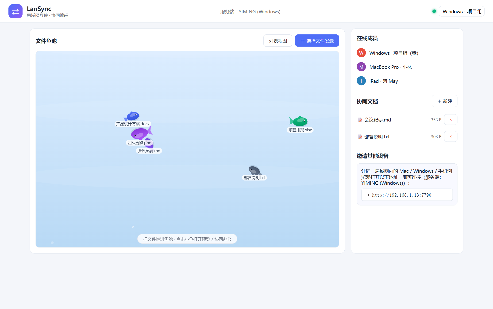
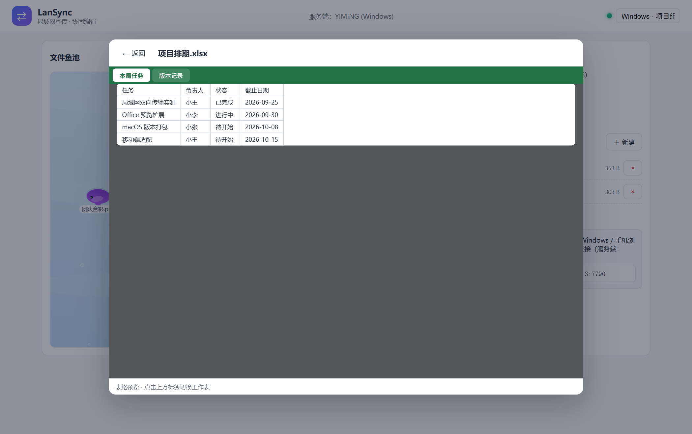
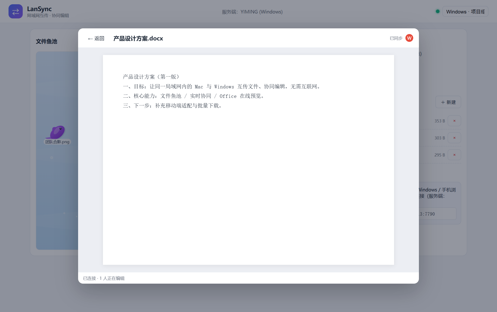
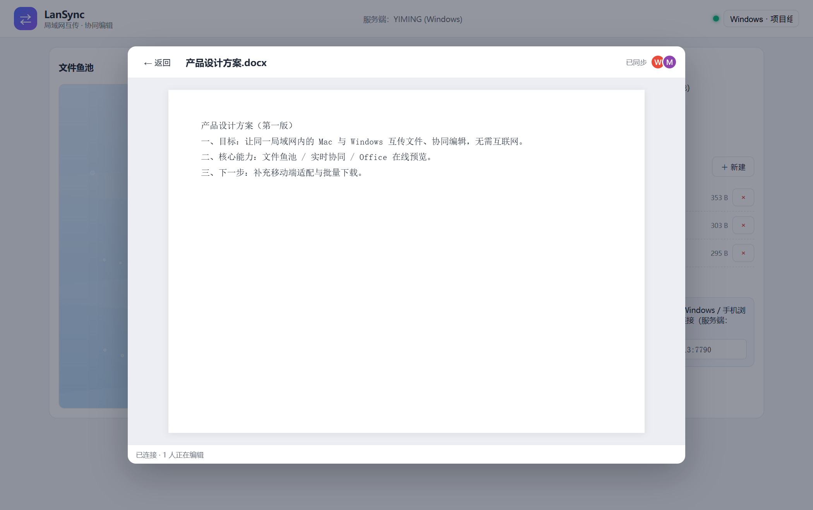
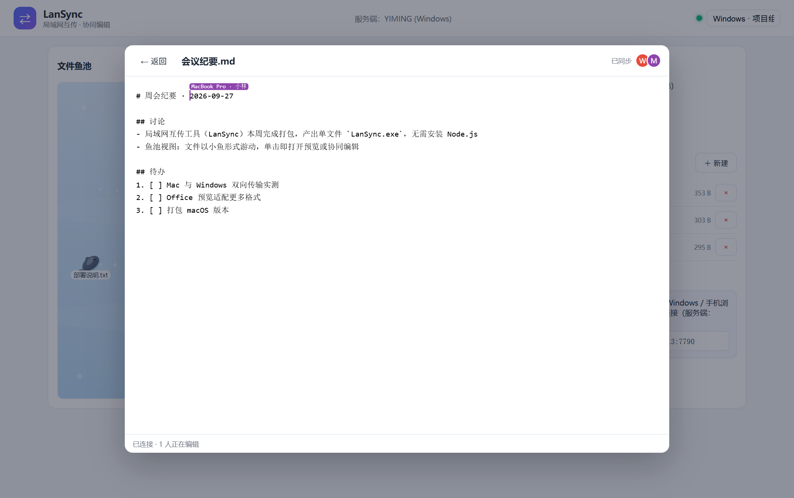

# LanSync

**把文件丢进「鱼池」，同一局域网里所有设备立刻看得见。**

局域网文件互传 + Office 在线预览 + 多人实时协同编辑。任选一台电脑当主机跑起来，其他设备（Mac / Windows / 手机）只要用浏览器打开一个局域网地址就能用——**不用注册、不用连外网、数据一个字节都不出局域网**。


> **Windows 想直接用？** → [下载 LanSync.exe](https://github.com/gaawal/LanSync/releases/latest/download/LanSync.exe)（单文件，双击就跑）

---

## 界面一览

### 1. 文件鱼池 —— 丢文件，就是放鱼苗



- 点「选择文件发送」，或**直接把文件拖进鱼池**，水花一溅，文件就变成一条小鱼开始游动
- 鱼的颜色按类型区分（Word 蓝 / Excel 绿 / PPT 橙 / PDF 红 / 图片紫 / 视频粉…），鱼的大小随文件体积变化
- 小鱼会随机游动、遇到池壁掉头、互相避让，池底有气泡和光带
- **单击任意一条小鱼**，就按它的类型打开：Word / 文本进协同编辑器，其余进预览
- 右侧三栏分别是「在线成员」「协同文档」「邀请其他设备」——最后那栏里的地址直接发给同事，对方浏览器打开即可加入

### 2. 列表视图 —— 习惯传统表格的话


右上角一键切换。列表里每个文件都有明确按钮：可协同的显示「协同编辑 + 预览」，图片/PDF 显示「预览」，以及「下载」「删除」，文件名下方标注大小、上传者和时间。

### 3. 在线预览 —— 打开就能看，不用下载

**图片**（png / jpg / gif / webp / svg / bmp…）：自适应窗口高度，点一下可在「适应窗口 / 原始大小」间切换。


**Excel**（xlsx / xls / csv）：多 Sheet 标签切换，表格按原始数据渲染。



**Word**（docx）：按原版式渲染分页效果。



**PPT**（pptx）：按页渲染幻灯片。**PDF** 用浏览器内嵌查看器，可直接滚动翻页。

> 所有预览都在**浏览器本地**完成，渲染库（docx-preview / SheetJS / mammoth / pptx-preview / html-docx-js）已内置在 `public/vendor/`，局域网里没有外网照样用。

### 4. 协同编辑 —— 多人同时改，不用来回传文件

**Word 协同**：点开 .docx 就进入富文本协同编辑器，多人同时编辑实时可见，右上角显示「已同步」和正在编辑的人；停止输入 2.5 秒后**自动转回 .docx 覆写原文件**——Mac 上改的内容，Windows 那边下载到的就是最新版。



**文本协同**（md / txt / 代码等）：带**彩色昵称光标**，能看见对方在哪一行、哪一根光标处打字。



两者都基于同一套 OT（Operation Transformation）算法：多人同时插入、删除不会互相覆盖，也不会两端分叉。

### 5. 传输进度 —— 发了多少、收了多少，都看得见


右下角悬浮面板，**发送（⬆）和接收/下载（⬇）都有**：文件名 + `已传 / 总大小 · 百分比` + 进度条，完成后变绿打勾、2.5 秒后自动收起，失败变红并写明原因。

---

## 功能清单

| 能力 | 说明 |
|---|---|
| 文件互传 | 拖拽或点选，任意类型任意大小，局域网内所有人可见可下载 |
| 传输进度 | 上传、下载都有大小 / 百分比 / 进度条 |
| 在线预览 | docx、xlsx/xls/csv、pptx、PDF、各种图片，全部本地渲染 |
| 文本协同 | md/txt/代码等，实时同步 + 彩色昵称光标，自动保存回原文件 |
| Word 协同 | docx → 富文本协同编辑 → 自动回写 .docx |
| 在线成员 | 实时显示当前连着谁，各自一条颜色 |
| 邀请 | 自动列出本机所有局域网 IP，直接发给对方 |
| 单文件分发 | [Releases](https://github.com/gaawal/LanSync/releases) 直接下载免装 Node 的 `LanSync.exe` |

## 快速开始

### 方式一：单文件 exe（Windows，推荐）

**直接下载 → [LanSync.exe](https://github.com/gaawal/LanSync/releases/latest/download/LanSync.exe)**（约 83 MB，免安装）

在 [Releases 页](https://github.com/gaawal/LanSync/releases) 还能拿到 `USAGE.txt`（使用说明）和 `LanSync.exe.sha256`（校验值，`certutil -hashfile LanSync.exe SHA256` 比对）。

1. 双击 `LanSync.exe`，会自动打开浏览器；控制台窗口里会打印局域网地址：

   ```
   其他设备打开:  http://192.168.1.13:7788
   ```

2. 把地址发给 Mac / 手机，浏览器打开即可。
3. 数据存在 **exe 同目录的 `shared/`**，重启不丢；**关掉那个控制台窗口 = 停止服务**。
4. 首次运行若弹出 Windows 防火墙提示，勾选「允许访问（专用网络）」。

> 端口被占用：`set PORT=7799 && LanSync.exe`

### 方式二：Node 源码（Windows / macOS）

```bash
npm install
npm start                     # 默认 7788 端口
# 或
PORT=7799 npm start
```

Windows 双击 `start.bat`，macOS 双击 `start.command`（首次需要 `chmod +x start.command`）。

### 方式三：打包成 exe

```bash
npm install
npm run build:win             # 产物 dist/LanSync.exe
```

打包用 [@yao-pkg/pkg](https://github.com/yao-pkg/pkg)，把服务端代码、依赖和 `public/` 全部塞进单个 exe。

> **国内网络注意**：pkg 需要下载基础 Node 二进制，GitHub 直连大概率超时，失败后它会退回「从源码编译 Node」并白等很久。先跑一次镜像下载再打包：
>
> ```bash
> python tools/fetch-pkg-base.py
> npm run build:win
> ```

## 支持的文件格式

| 类型 | 扩展名 | 能力 |
|---|---|---|
| Word | `.docx` | 预览 + **多人协同编辑**（自动回写） |
| 表格 | `.xlsx` `.xls` `.csv` | 预览，多 Sheet 切换 |
| 幻灯片 | `.pptx` | 预览，按页渲染 |
| PDF | `.pdf` | 内嵌查看器预览 |
| 图片 | `.png` `.jpg` `.jpeg` `.gif` `.webp` `.svg` `.bmp` `.ico` | 预览，自适应窗口 |
| 文本 | `.md` `.txt` `.json` `.csv` `.log` `.js` `.ts` `.py` `.html` `.css` 等 | **多人协同编辑**（自动回写） |
| 其它 | 任意 | 传输 + 下载（视频、压缩包、安装包都没问题） |

老格式 `.doc` / `.ppt`（Office 97-2003）不支持在线预览，请先另存为 `.docx` / `.pptx`。

## 工作原理

```
                ┌──────────── 主机（任意一台电脑） ─────────────┐
   浏览器 A ──► │  HTTP   : 静态页面 / 上传 / 下载 / 预览         │ ◄── 浏览器 B
   （Mac）      │  WS     : 协同编辑（OT 变换，服务端权威版本）    │     （Windows）
                │  shared/: files/ 原文件   docs/ 协同文档中间态  │
                └───────────────────────────────────────────────┘
                            局域网，无外部依赖
```

- **单进程 Node 服务**：一个 `http.Server` 同时对外提供静态页面、文件收发接口和 WebSocket
- **协同编辑**：服务端持有权威版本与操作历史；客户端本地立即生效并排队等待 ack，收到别人的操作时用 `transformOp` 变换后应用。同位置并发用 `uid` 做 tie-break；「插入落在删除范围内」统一约定为**删除吞掉插入**（空插入视为 no-op），保证任意并发下两端内容收敛一致
- **文件落盘**：原文件存 `shared/files/`，协同文档中间态存 `shared/docs/`；文本文件的改动会自动写回原文件

## 项目结构

```
server.js                 服务端全部逻辑（HTTP + WebSocket + OT + 持久化）
public/
  index.html              页面结构
  style.css               样式
  app.js                  前端逻辑（三模式编辑器、OT 客户端、预览、传输进度）
  fishpond.js             鱼池视图（Canvas 绘制小鱼与水面）
  vendor/                 5 个本地渲染库（离线可用，约 3MB）
tools/
  make-demo-data.py       生成演示数据（纯标准库）
  screenshots.js          生成 README 截图（本机 Chrome + puppeteer-core）
  fetch-pkg-base.py       镜像下载 pkg 基础二进制（国内打包用）
test-collab.js            双客户端 OT 收敛测试（4 个并发场景）
test-frontend.js          前端端到端测试（本地输入落盘 / 远端操作刷新）
test-office.js            Word 协同链路测试（上传→协同→回写→下载）
test-download.js          下载进度测试（含限速流验证中途刷新）
start.bat / start.command Windows / macOS 启动脚本
```

## 接口

| 方法 | 路径 | 说明 |
|---|---|---|
| GET | `/api/info` | 主机名、局域网 IP、端口、文件与文档列表 |
| POST | `/api/upload` | 上传（文件名走 `X-File-Name` 头，文本文件自动建协同文档） |
| GET | `/api/download?id=` | 下载；加 `&inline=1` 则内联显示（预览用） |
| POST | `/api/file/content` | 覆写文件内容（Word 协同回写 .docx 用） |
| DELETE | `/api/file?id=` | 删除文件 |
| POST | `/api/docs` | 新建协同文档 |
| POST | `/api/docs/open-office` | 打开 Office 文件对应的协同文档 |
| POST | `/api/docs/delete` | 删除协同文档 |
| WS | `/ws` | 协同编辑：`hello` / `join` / `op` / `cursor` / `replace` 与 `init` / `ack` / `users` 广播 |

## 测试

```bash
# 默认测 http://localhost:7788，可用 LANSYNC_BASE 指定别的实例
node test-collab.js <docId>      # 需要先建一个文档
node test-frontend.js            # 会自建并自删测试文档
node test-download.js
node test-office.js              # 需要 test-doc.docx
```

回归范围：OT 四种并发场景两端内容一致、本地输入自动落盘、远端操作实时刷新、上传下载字节完整、限速情况下进度中途实时刷新、Word 协同全链路（上传 → 协同编辑 → 回写 .docx → 下载校验）。

## 常见问题

**对方打不开地址？**
两台机器要在同一网段；Windows 防火墙放行 7788 端口（首次运行记得点「允许访问」）；关掉可能拦截的杀毒软件试试。

**想换端口？** exe 用 `set PORT=7799 && LanSync.exe`，源码用 `PORT=7799 npm start`。

**文件存在哪？** 原文件在 `shared/files/`，协同文档中间态在 `shared/docs/`，重启不丢。exe 版的 `shared/` 在 exe 同目录。

**Mac 上怎么跑？** 装好 Node 后 `npm install && npm start`；或双击 `start.command`。客户端只是网页，Mac / Windows / 手机都能直接连。

**复杂 Word 样式会变吗？** 协同编辑保存的是内容与基本格式（标题、加粗、图片、表格），页眉页脚、艺术字这类复杂样式会有简化——预览则按原版式渲染。

## 已知限制

- Excel 预览是只读表格视图，不重算公式（要看公式结果请在本地 Office 打开）
- pptx 预览按页静态渲染，不支持播放动画/视频
- 同一份文档的**协同编辑与预览二选一**：预览只读，要改请点「协同编辑」
- 单个大文件（几百 MB 以上）建议用传输功能，别开预览
- 没有账号体系，能连上局域网地址的人就能访问——请只在可信网络里使用

## 隐私

文件只在你的局域网里流转：主机上的 `shared/` 是唯一存储位置，没有任何上报、遥测或云同步。
